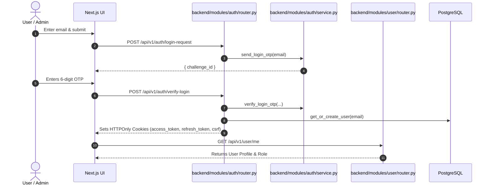
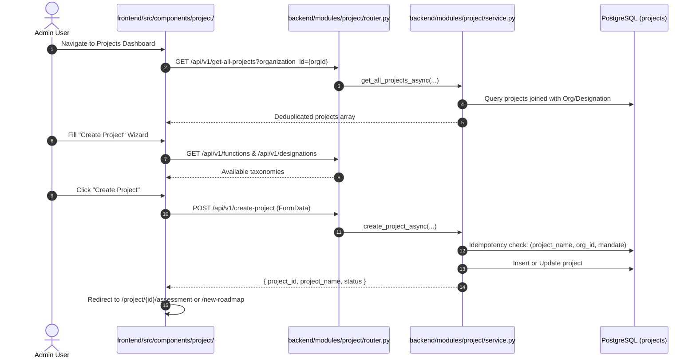
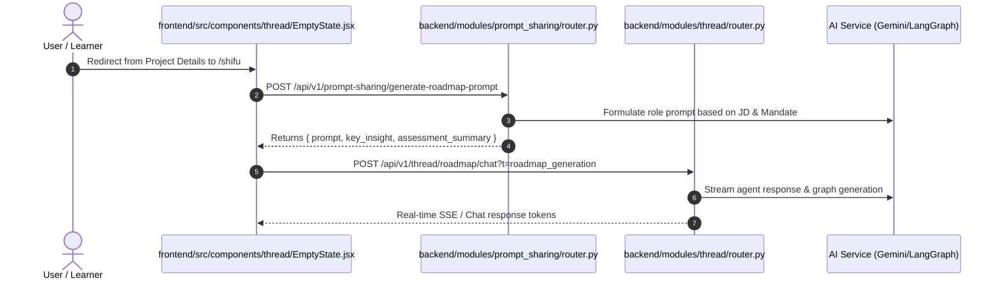
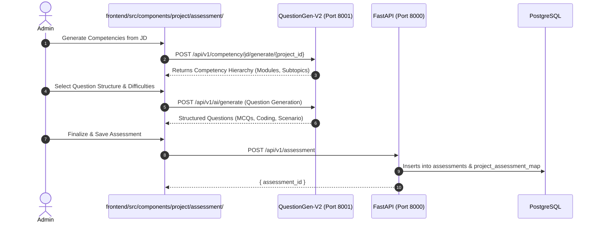
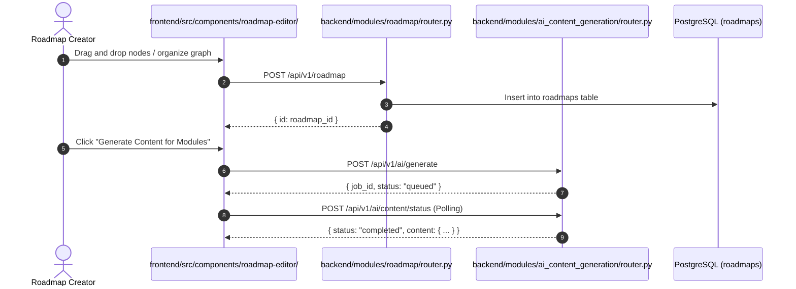
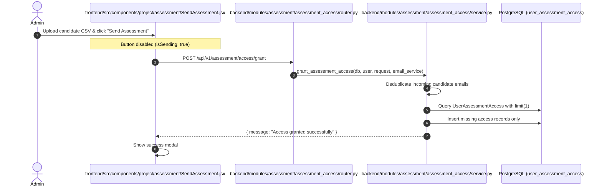
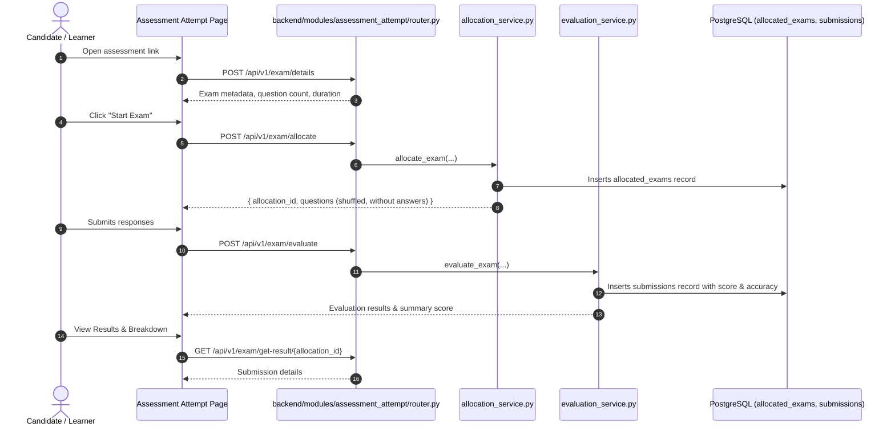
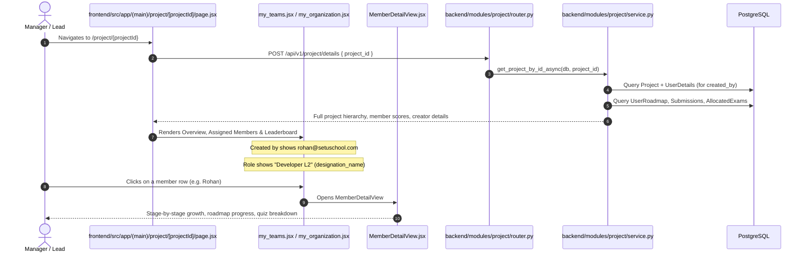

# End-to-End API Flow Architecture & Calling Sequence

This document provides a comprehensive, sequential, story-driven blueprint of all API calls across the platform—from initial authentication and session bootstrapping to project creation, assessment generation, roadmap editing, candidate allocation, quiz attempts, real-time leaderboards, and Shifu AI prompt sharing.

---

## High-Level Architecture & Connectivity

```
[ Next.js Frontend (Port 3000) ]
        │
        ├── Standard HTTP Requests (Axios with withCredentials, CSRF Token)
        │       ▼
[ FastAPI Main Backend (Port 8000) ] ──▶ PostgreSQL (`setu_lms_v1_demo_4`)
        │                              ──▶ Redis / Celery Async Tasks
        │                              ──▶ Azure Blob Storage (JD & CSV Assets)
        │
        └── AI Question Generation Service (Port 8001)
                ▼
[ QuestionGen-V2 Microservice ] ──▶ LLM (Gemini / Anthropic)
```

### Authentication & Interceptor Mechanics
- **Base URL**: `http://localhost:8000/api/v1` (configured via `NEXT_PUBLIC_API_SERVER_URL` in `frontend/.env`).
- **HTTP Client**: [`frontend/src/lib/axios.js`](file:///c:/Users/Admin/Downloads/code_sharing_31082026/frontend/src/lib/axios.js).
- **Credentials & Security**:
  - `withCredentials: true`: Automatic transmission of `access_token`, `refresh_token`, and `csrf` cookies.
  - **Request Interceptor**: Extracts `csrf` token from document cookies and injects `X-CSRF-Token` header.
  - **Response Interceptor**: Automatically catches `401 TOKEN_EXPIRED`, triggers `POST /api/v1/auth/refresh`, and transparently replays the original request.
- **Organization Context**: Stored in `localStorage` via [`frontend/src/lib/orgContext.js`](file:///c:/Users/Admin/Downloads/code_sharing_31082026/frontend/src/lib/orgContext.js) (`organizationId`, `teamId`).

---

## 1. Authentication & User Onboarding Flow



### Step 1.1: Request Login OTP
- **User Story**: The user opens the login page and submits their corporate email address.
- **Frontend Caller**: 
  - File: `frontend/src/components/auth/LoginForm.jsx`
  - Function: `handleSendOtp()` via `auth.service.js` -> `sendOtp(email)`
- **HTTP Request**:
  - `POST http://localhost:8000/api/v1/auth/login-request`
  - Headers: `Content-Type: application/json`
  - Payload:
    ```json
    { "email": "rohan@setuschool.com" }
    ```
- **Backend Handling**:
  - Router: [`backend/modules/auth/router.py`](file:///c:/Users/Admin/Downloads/code_sharing_31082026/backend/modules/auth/router.py#L27) (`@router.post("/login-request")`)
  - Handler Function: `login_request(request, auth_service, user_service)`
  - Service Function: `AuthService.send_login_otp(email)` in [`backend/modules/auth/service.py`](file:///c:/Users/Admin/Downloads/code_sharing_31082026/backend/modules/auth/service.py)
  - Tables / DB: Generates challenge in Redis or `auth_challenges`.
- **Response**:
  - HTTP `200 OK`
  - Payload:
    ```json
    { "challenge_id": "9a38f712-8821-4db5-9e45-128a55bca982" }
    ```

### Step 1.2: Verify OTP & Issue Session Tokens
- **User Story**: The user inputs the 6-digit verification code.
- **Frontend Caller**: 
  - File: `frontend/src/components/auth/OtpVerifyForm.jsx`
  - Function: `handleVerifyOtp()` via `auth.service.js` -> `verifyOtp(email, otp, challengeId)`
- **HTTP Request**:
  - `POST http://localhost:8000/api/v1/auth/verify-login`
  - Headers: `Content-Type: application/json`
  - Payload:
    ```json
    {
      "email": "rohan@setuschool.com",
      "otp": "123456",
      "challenge_id": "9a38f712-8821-4db5-9e45-128a55bca982"
    }
    ```
- **Backend Handling**:
  - Router: [`backend/modules/auth/router.py`](file:///c:/Users/Admin/Downloads/code_sharing_31082026/backend/modules/auth/router.py#L42) (`@router.post("/verify-login")`)
  - Handler Function: `verify_login(request, user_service, auth_service, organization_service)`
  - Logic:
    1. `auth_service.verify_login_otp(...)` validates OTP.
    2. `organization_service.onboard_user_to_organization_by_email_domain(email)` associates user with org based on domain.
    3. `user_service.get_or_create_user(email)` queries/inserts `UserDetails`.
    4. `auth_service.create_session(...)` inserts into `user_sessions`.
    5. Sets three cookies: `access_token`, `refresh_token`, and `csrf`.
- **Response**:
  - HTTP `200 OK` with Set-Cookie headers:
    - `access_token`: JWT (Subject: `user_id`, Claims: `jti`, `sid`)
    - `refresh_token`: JWT (Subject: `user_id`, Claims: `jti`, `sid`, `csrf`)
    - `csrf`: CSRF token string

### Step 1.3: Fetch Current User Profile (`/user/me`)
- **User Story**: The Next.js app mounts, verifies authentication state, and populates the Zustand `authStore`.
- **Frontend Caller**: 
  - File: `frontend/src/store/authStore.js`
  - Function: `fetchCurrentUser()` -> `axios.get('/user/me')`
- **HTTP Request**:
  - `GET http://localhost:8000/api/v1/user/me`
  - Headers: `X-CSRF-Token: <token>`, Cookies: `access_token=...`
- **Backend Handling**:
  - Router: [`backend/modules/user/router.py`](file:///c:/Users/Admin/Downloads/code_sharing_31082026/backend/modules/user/router.py#L11) (`@router.get("/me")`)
  - Handler Function: `get_me(user, user_service)`
  - Service Function: `UserService.get_user_details(user)`
  - Security Dependency: `get_current_user` validates JWT and fetches `UserDetails` from database.
- **Response**:
  - HTTP `200 OK`
  - Payload:
    ```json
    {
      "user_id": "01a0322f-7354-7541-bbe7-ad53bd0824d2",
      "user_email": "rohan@setuschool.com",
      "user_name": "Rohan",
      "role": "Admin",
      "organization_id": "01a01f47-833a-7810-8b01-3ab4e9743175"
    }
    ```

### Step 1.4: Fetch User Organizations & Teams
- **User Story**: Loads organization switcher and sets active context.
- **Frontend Caller**: 
  - File: `frontend/src/components/layout/Header.jsx`
  - API: `GET /organizations` and `GET /organizations/{organization_id}/teams`
- **Backend Handling**:
  - Router: [`backend/modules/organization/router.py`](file:///c:/Users/Admin/Downloads/code_sharing_31082026/backend/modules/organization/router.py#L37) and [`backend/modules/team/router.py`](file:///c:/Users/Admin/Downloads/code_sharing_31082026/backend/modules/team/router.py#L30)
  - Tables Queried: `organization_members`, `organizations`, `teams`.

---

## 2. Project Creation & Dashboard Management



### Step 2.1: List All Projects (With Idempotent Deduplication)
- **User Story**: User lands on `/project`, `/project?mandate=team`, or `/project?mandate=organization`.
- **Frontend Caller**:
  - File: [`frontend/src/components/project/newprojectDashboard.jsx`](file:///c:/Users/Admin/Downloads/code_sharing_31082026/frontend/src/components/project/newprojectDashboard.jsx#L207)
  - Function: `fetchProjects()` via `axios.get('/get-all-projects?organization_id=...')`
- **HTTP Request**:
  - `GET http://localhost:8000/api/v1/get-all-projects?organization_id=01a01f47-833a-7810-8b01-3ab4e9743175`
- **Backend Handling**:
  - Router: [`backend/modules/project/router.py`](file:///c:/Users/Admin/Downloads/code_sharing_31082026/backend/modules/project/router.py#L235) (`@router.get("/get-all-projects")`)
  - Handler Function: `get_projects(organization_id, db, user)`
  - Service Function: `get_all_projects_async(db, organization_id, current_user_id)` in [`backend/modules/project/service.py`](file:///c:/Users/Admin/Downloads/code_sharing_31082026/backend/modules/project/service.py#L1112)
  - **Deduplication Logic**: Orders projects by `created_at DESC` and deduplicates by `(project_name.lower().strip(), project_mandate)`.
- **Response**:
  - HTTP `200 OK`
  - Array of deduplicated projects with `project_id`, `project_name`, `designation_name`, `function_name`, `project_status`, `project_details`.

### Step 2.2: Load Functions & Designations for Role Creation
- **User Story**: In the Project creation wizard, the user picks or types Job Functions and Designations.
- **Frontend Caller**:
  - File: [`frontend/src/components/project/CreateProject_v2.jsx`](file:///c:/Users/Admin/Downloads/code_sharing_31082026/frontend/src/components/project/CreateProject_v2.jsx)
  - Functions: `getFunctions()`, `getDesignations()` via [`frontend/src/service/project.service.js`](file:///c:/Users/Admin/Downloads/code_sharing_31082026/frontend/src/service/project.service.js)
- **HTTP Requests**:
  - `GET http://localhost:8000/api/v1/functions?organization_id=...`
  - `GET http://localhost:8000/api/v1/designations?organization_id=...`
- **Backend Handling**:
  - Router: [`backend/modules/project/router.py`](file:///c:/Users/Admin/Downloads/code_sharing_31082026/backend/modules/project/router.py#L32-L37)
  - Handler Functions: `get_functions()`, `get_designations()`
  - Service Functions: `get_functions_async(db, organization_id)`, `get_designations_async(db, organization_id)`

### Step 2.3: Create or Idempotently Update Project
- **User Story**: User enters role name (e.g. "python developer"), selects mandate ("team" / "organization"), selects what to create ("roadmap", "assessment", or "both"), optionally uploads JD, and clicks submit.
- **Frontend Caller**:
  - File: [`frontend/src/components/project/CreateProject_v2.jsx`](file:///c:/Users/Admin/Downloads/code_sharing_31082026/frontend/src/components/project/CreateProject_v2.jsx#L363)
  - Function: `handleCreateProject()` -> `createProject(projectData, jdFile)` in [`project.service.js`](file:///c:/Users/Admin/Downloads/code_sharing_31082026/frontend/src/service/project.service.js#L21)
- **HTTP Request**:
  - `POST http://localhost:8000/api/v1/create-project`
  - Headers: `Content-Type: multipart/form-data`
  - FormData:
    - `project_name`: `"ai python engeenr"`
    - `organization_name`: `"Setuschool"`
    - `function_name`: `"Engineering"`
    - `designation_name`: `"Developer L2"`
    - `project_type`: `"roadmap"`
    - `project_mandate`: `"organization"`
    - `created_by`: `"01a0322f-7354-7541-bbe7-ad53bd0824d2"`
    - `jd_file`: (Binary / Optional)
- **Backend Handling**:
  - Router: [`backend/modules/project/router.py`](file:///c:/Users/Admin/Downloads/code_sharing_31082026/backend/modules/project/router.py#L40) (`@router.post("/create-project")`)
  - Handler Function: `create_project(project_data, file, db, user)`
  - Service Function: `create_project_async(db, project_in, file)` in [`service.py`](file:///c:/Users/Admin/Downloads/code_sharing_31082026/backend/modules/project/service.py#L102-L142)
  - **Idempotency Guard**:
    ```python
    existing_stmt = select(Project).where(
        func.lower(func.trim(Project.project_name)) == project_in.project_name.strip().lower(),
        Project.organization_id == org.organization_id
    )
    ```
    If matched, it updates the existing project record; otherwise, it inserts a new `Project` record.
- **Response**:
  - HTTP `200 OK`
  - Returns `ProjectResponse` containing `project_id`.

---

## 3. Shifu AI Chat & Prompt Sharing Flow



### Step 3.1: Generate Structured Role Prompt (`/prompt-sharing`)
- **User Story**: User redirects to Shifu AI with a project context or clicks "Generate Roadmap with AI".
- **Frontend Caller**:
  - File: [`frontend/src/components/thread/EmptyState.jsx`](file:///c:/Users/Admin/Downloads/code_sharing_31082026/frontend/src/components/thread/EmptyState.jsx)
  - Function: `generatePromptRoadmap()` via [`frontend/src/service/promptSharing.service.js`](file:///c:/Users/Admin/Downloads/code_sharing_31082026/frontend/src/service/promptSharing.service.js#L13)
- **HTTP Request**:
  - `POST http://localhost:8000/api/v1/prompt-sharing/generate-roadmap-prompt`
  - Headers: `Content-Type: multipart/form-data`
  - Form Fields:
    - `who_is_this_for`: `"Organization"`
    - `what_to_create`: `"roadmap"`
    - `project_id`: `"f5c1e0be-5460-4329-a022-bb76c793cebd"`
    - `role_description_text`: `"Python API developer..."`
- **Backend Handling**:
  - Router: [`backend/modules/prompt_sharing/router.py`](file:///c:/Users/Admin/Downloads/code_sharing_31082026/backend/modules/prompt_sharing/router.py#L16)
  - Service Function: `PromptSharingService.generate_roadmap_prompt(...)` in [`backend/modules/prompt_sharing/service.py`](file:///c:/Users/Admin/Downloads/code_sharing_31082026/backend/modules/prompt_sharing/service.py)
  - Pulls JD data from `projects.project_details["jd_data"]` and formats prompt templates.
- **Response**:
  - HTTP `200 OK`
  - Schema:
    ```json
    {
      "prompt": "I am preparing for a role focused on Python Developer...",
      "key_insight": "Mastering FastAPI and asynchronous programming...",
      "assessment_summary": "Domain: Python Developer L2..."
    }
    ```

### Step 3.2: AI Shifu Interactive Thread Execution
- **User Story**: The generated prompt initiates an AI conversation thread that synthesizes learning milestones.
- **Frontend Caller**:
  - File: `frontend/src/components/thread/ChatArea.jsx`
  - Service: `thread.service.js` -> `sendRoadmapChatMessage(data)`
- **HTTP Request**:
  - `POST http://localhost:8000/api/v1/thread/roadmap/chat?t=roadmap_generation`
- **Backend Handling**:
  - Router: [`backend/modules/thread/router.py`](file:///c:/Users/Admin/Downloads/code_sharing_31082026/backend/modules/thread/router.py#L33)
  - Service Function: `ThreadService.start_roadmap_generation_thread(...)`
  - LangGraph checkpointer persists thread state into `chat_threads` and `conversation_messages`.

---

## 4. Skill-Gap Assessment Generation Flow



### Step 4.1: Generate Competencies from Job Description
- **User Story**: System automatically parses the role JD into measurable skill competencies.
- **Frontend Caller**:
  - File: `frontend/src/components/project/assessment/SourceOfCompetencies.jsx`
  - Service: `generateCompetency(projectId)` in [`frontend/src/service/assessment.service.js`](file:///c:/Users/Admin/Downloads/code_sharing_31082026/frontend/src/service/assessment.service.js#L57)
- **HTTP Request**:
  - `POST http://localhost:8001/api/v1/competency/jd/generate/f5c1e0be-5460-4329-a022-bb76c793cebd`
- **QuestionGen-V2 Handling**:
  - Extracts JD text, invokes Gemini prompt, and returns skill tree with Bloom's taxonomy ratings.

### Step 4.2: Generate Assessment Question Bank
- **User Story**: Generates questions based on topics, difficulty distribution, and time limits.
- **Frontend Caller**:
  - File: `frontend/src/components/project/assessment/QuestionsStructure.jsx`
  - Service: `generateQuestions(data)` in [`assessment.service.js`](file:///c:/Users/Admin/Downloads/code_sharing_31082026/frontend/src/service/assessment.service.js#L51)
- **HTTP Request**:
  - `POST http://localhost:8001/api/v1/ai/generate`
- **Response**: Questions with options, correct answer keys, explanations, and difficulty ratings.

### Step 4.3: Persist Assessment Entity
- **User Story**: Administrator saves the finalized assessment to the project.
- **Frontend Caller**:
  - File: `frontend/src/components/project/assessment/CreateSkillGapAssessment.jsx`
  - Function: `handleSaveAssessment()` -> `createAssessment(data)` in [`assessment.service.js`](file:///c:/Users/Admin/Downloads/code_sharing_31082026/frontend/src/service/assessment.service.js#L18)
- **HTTP Request**:
  - `POST http://localhost:8000/api/v1/assessment`
  - Payload:
    ```json
    {
      "project_id": "f5c1e0be-5460-4329-a022-bb76c793cebd",
      "assessment_name": "Python Developer L2 Baseline Assessment",
      "assessment_type": "skill_gap_assessment",
      "structure": { ... },
      "organization_id": "01a01f47-833a-7810-8b01-3ab4e9743175"
    }
    ```
- **Backend Handling**:
  - Router: [`backend/modules/assessment/router.py`](file:///c:/Users/Admin/Downloads/code_sharing_31082026/backend/modules/assessment/router.py#L33) (`@router.post("")`)
  - Service Function: `AssessmentService.create_assessment(user, data)`
  - Tables Affected: Inserts into `assessments`, maps to project in `project_assessment_map`.

---

## 5. Roadmap Authoring & Content Generation Flow



### Step 5.1: Create Roadmap Entity
- **HTTP Request**: `POST http://localhost:8000/api/v1/roadmap`
- **Backend Router**: [`backend/modules/roadmap/router.py`](file:///c:/Users/Admin/Downloads/code_sharing_31082026/backend/modules/roadmap/router.py#L15)
- **Service**: `RoadmapService.create(data, user_id)` in [`backend/modules/roadmap/service.py`](file:///c:/Users/Admin/Downloads/code_sharing_31082026/backend/modules/roadmap/service.py)
- **Tables Affected**: Inserts row into `roadmaps` linked to `project_id`.

### Step 5.2: Update Roadmap Graph Structure
- **HTTP Request**: `PUT http://localhost:8000/api/v1/roadmap/{roadmap_id}`
- **Backend Router**: [`backend/modules/roadmap/router.py`](file:///c:/Users/Admin/Downloads/code_sharing_31082026/backend/modules/roadmap/router.py#L49)
- **Service**: `RoadmapService.update(...)`
- **Data Updated**: Updates `roadmap_graph` JSONB column (containing nodes, parent-child groups, edges).

### Step 5.3: Generate AI Educational Content
- **HTTP Request**: `POST http://localhost:8000/api/v1/ai/generate`
- **Backend Router**: [`backend/modules/ai_content_generation/router.py`](file:///c:/Users/Admin/Downloads/code_sharing_31082026/backend/modules/ai_content_generation/router.py#L33)
- **Service**: `ContentGenerationService.generate_roadmap_content_batch(...)`
- **Background Worker**: Celery task processes node content generation asynchronously; status polled via `POST /api/v1/ai/content/status`.

---

## 6. Granting Access to Team Members (Idempotent Flow)



### Step 6.1: Grant Assessment Access
- **User Story**: Admin enters or uploads candidate emails (e.g. `partha@setuschool.com`) and sends invites.
- **Frontend Caller**:
  - File: [`frontend/src/components/project/assessment/SendAssessment.jsx`](file:///c:/Users/Admin/Downloads/code_sharing_31082026/frontend/src/components/project/assessment/SendAssessment.jsx#L141)
  - Service: `grantAssessmentAccess(data)` in [`frontend/src/service/assessment.service.js`](file:///c:/Users/Admin/Downloads/code_sharing_31082026/frontend/src/service/assessment.service.js#L66)
- **HTTP Request**:
  - `POST http://localhost:8000/api/v1/assessment/access/grant`
  - Headers: `Content-Type: application/json`, `X-CSRF-Token: ...`
  - Payload:
    ```json
    {
      "assessment_id": "368d6e9b-8250-43d1-8deb-3f6a15268da4",
      "candidates": [
        { "name": "Partha", "email": "partha@setuschool.com" }
      ],
      "organization_id": "01a01f47-833a-7810-8b01-3ab4e9743175"
    }
    ```
- **Backend Handling**:
  - Router: [`backend/modules/assessment/assessment_access/router.py`](file:///c:/Users/Admin/Downloads/code_sharing_31082026/backend/modules/assessment/assessment_access/router.py#L21) (`@router.post("/grant")`)
  - Handler Function: `grant_access(request, user, email_service, db)`
  - Service Function: `grant_assessment_access(db, user, request, email_service)` in [`backend/modules/assessment/assessment_access/service.py`](file:///c:/Users/Admin/Downloads/code_sharing_31082026/backend/modules/assessment/assessment_access/service.py)
  - **Deduplication Safeguard**: Deduplicates candidates by lowercase email, checks existing `UserAssessmentAccess` with `.limit(1).scalars().first()`, preventing double-click duplicate insertions.
- **Response**:
  - HTTP `201 Created`
  - Payload: `{ "message": "Access granted successfully" }`

### Step 6.2: Grant Roadmap Access
- **User Story**: Admin or author shares roadmap viewing or editor access with colleagues.
- **Frontend Caller**:
  - File: [`frontend/src/components/roadmap-editor/RoadmapAccessSharing.jsx`](file:///c:/Users/Admin/Downloads/code_sharing_31082026/frontend/src/components/roadmap-editor/RoadmapAccessSharing.jsx#L375)
  - Service: `grantAccess(roadmapId, access, notify)` in [`frontend/src/service/roadmapAccess.service.js`](file:///c:/Users/Admin/Downloads/code_sharing_31082026/frontend/src/service/roadmapAccess.service.js#L4)
- **HTTP Request**:
  - `POST http://localhost:8000/api/v1/grant-access`
  - Payload:
    ```json
    {
      "roadmap_id": "f5c1e0be-5460-4329-a022-bb76c793cebd",
      "notify": true,
      "access": [
        { "email": "rohan@setuschool.com", "level": "viewer", "sharing_mode": "access_shared_by_admin" }
      ]
    }
    ```
- **Backend Handling**:
  - Router: [`backend/modules/roadmap/roadmap_access_router.py`](file:///c:/Users/Admin/Downloads/code_sharing_31082026/backend/modules/roadmap/roadmap_access_router.py#L19) (`@router.post("/grant-access")`)
  - Service Function: `RoadmapAccessService.grant_users_roadmap_access(...)` in [`backend/modules/roadmap/roadmap_access_service.py`](file:///c:/Users/Admin/Downloads/code_sharing_31082026/backend/modules/roadmap/roadmap_access_service.py#L28)
  - Upserts into `user_roadmap` and properly stores hashed email for user lookup.

---

## 7. Candidate Examination Attempt & Evaluation Flow



### Step 7.1: Fetch Exam Details
- **HTTP Request**: `POST http://localhost:8000/api/v1/exam/details`
- **Backend Router**: [`backend/modules/assessment_attempt/router.py`](file:///c:/Users/Admin/Downloads/code_sharing_31082026/backend/modules/assessment_attempt/router.py#L51)
- **Service**: `ExamService.get_exam_details(user, ...)`

### Step 7.2: Allocate Exam to Candidate
- **HTTP Request**: `POST http://localhost:8000/api/v1/exam/allocate`
- **Backend Router**: [`backend/modules/assessment_attempt/router.py`](file:///c:/Users/Admin/Downloads/code_sharing_31082026/backend/modules/assessment_attempt/router.py#L69)
- **Service**: `ExamAllocationService.allocate_exam(user, data, user_agent)`
- **Tables Affected**: Inserts a new record into `allocated_exams` with an encrypted `allocation_id` and test question snapshots.

### Step 7.3: Evaluate Exam Submission
- **HTTP Request**: `POST http://localhost:8000/api/v1/exam/evaluate`
- **Backend Router**: [`backend/modules/assessment_attempt/router.py`](file:///c:/Users/Admin/Downloads/code_sharing_31082026/backend/modules/assessment_attempt/router.py#L85)
- **Service**: `ExamEvaluationSerice.evaluate_exam(user, payload)`
- **Tables Affected**:
  - Compares candidate answers with key.
  - Inserts row into `submissions` (storing `obtained_percentage`, `total_number_of_correct_answer`, `submission_time`, `score`).

### Step 7.4: Fetch Examination Result
- **HTTP Request**: `GET http://localhost:8000/api/v1/exam/get-result/{allocation_id}`
- **Backend Router**: [`backend/modules/assessment_attempt/router.py`](file:///c:/Users/Admin/Downloads/code_sharing_31082026/backend/modules/assessment_attempt/router.py#L98)
- **Service**: `ExamEvaluationSerice.get_submission_by_allocation_id(user, allocation_id)`

### Step 7.5: Update Node Learning Progress
- **User Story**: As the candidate marks modules complete in their roadmap learning journey, the node status updates.
- **HTTP Request**: `PUT http://localhost:8000/api/v1/learning-progress/{roadmap_id}`
- **Backend Router**: [`backend/modules/learning_progress/router.py`](file:///c:/Users/Admin/Downloads/code_sharing_31082026/backend/modules/learning_progress/router.py#L32)
- **Service**: `LearningProgressService.update_learning_progress(user_id, roadmap_id, node_id, status)`
- **Tables Affected**: Updates `user_roadmap.user_roadmap_data["learning_progress"][node_id]`.

---

## 8. Project Analytics, Members & Leaderboard Flow



### Step 8.1: Fetch Aggregated Project Details (`/project/details`)
- **User Story**: The user opens an active project from the dashboard to review allocations, progress, or leaderboards.
- **Frontend Caller**:
  - File: [`frontend/src/app/(main)/project/[projectId]/page.jsx`](file:///c:/Users/Admin/Downloads/code_sharing_31082026/frontend/src/app/(main)/project/[projectId]/page.jsx#L20)
  - Function: `fetchProjectDetails()` -> `axios.post('/project/details', { project_id: projectId })`
- **HTTP Request**:
  - `POST http://localhost:8000/api/v1/project/details`
  - Payload:
    ```json
    { "project_id": "f5c1e0be-5460-4329-a022-bb76c793cebd" }
    ```
- **Backend Handling**:
  - Router: [`backend/modules/project/router.py`](file:///c:/Users/Admin/Downloads/code_sharing_31082026/backend/modules/project/router.py#L254-L266) (`@router.post("/project/details")`)
  - Handler Function: `get_project_details(request_data, db)`
  - Service Function: `get_project_by_id_async(db, project_id)` in [`backend/modules/project/service.py`](file:///c:/Users/Admin/Downloads/code_sharing_31082026/backend/modules/project/service.py#L464)
  - **Key Operations**:
    1. Joins `projects`, `organizations`, `functions`, `designations`.
    2. Resolves `created_by` against `UserDetails` to populate `created_by_email` (`rohan@setuschool.com`) and `created_by_name` (`Rohan`).
    3. Traverses associated roadmaps (`roadmaps`, `user_roadmap`) and assessments (`project_assessment_map`, `user_assessment_access`, `allocated_exams`, `submissions`).
    4. Applies role designation inheritance:
       ```python
       project_designation = desig_name or (project.project_details or {}).get("designation_name")
       designation = project_designation or user.designation_specialization or "Software Developer"
       ```
    5. Calculates member roadmap progress percentage, chapter grouping, quiz averages, and capstone status.
- **Response**:
  - HTTP `200 OK`
  - Schema:
    ```json
    {
      "project_id": "f5c1e0be-5460-4329-a022-bb76c793cebd",
      "project_name": "ai python engeenr",
      "organization_name": "Setuschool",
      "function_name": "Developer",
      "designation_name": "Developer L2",
      "project_status": { "status": "active" },
      "created_at": "2026-09-17T07:08:26.756841Z",
      "created_by": "01a0322f-7354-7541-bbe7-ad53bd0824d2",
      "created_by_name": "Rohan",
      "created_by_email": "rohan@setuschool.com",
      "project_details": {
        "project_type": "roadmap",
        "project_mandate": "organization"
      },
      "profiles_count": 2,
      "assigned_members": [
        {
          "id": "01a0322f-7354-7541-bbe7-ad53bd0824d2",
          "name": "Rohan",
          "email": "rohan@setuschool.com",
          "role": "Admin",
          "designation": "Developer L2",
          "department": "Developer",
          "status": "In progress",
          "progress": 3,
          "completed_nodes": 1,
          "total_nodes": 36,
          "user_quizzes": [ ... ],
          "roadmap_chapters": [ ... ]
        }
      ]
    }
    ```

### Step 8.2: Render Views with Resolved Metadata
- **`MyTeams` / `MyOrganization`**:
  - **Created by**: Displays `projectData.created_by_email` (`rohan@setuschool.com`) instead of raw UUID or fallback org name.
  - **Employee Subtext**: Uses `member.role = m.designation || projectData?.designation_name || m.role`, showing **"Developer L2"** under Rohan and Partha instead of `"Software Developer"`.
- **`MemberDetailView`**:
  - Displays header role as `memberRole = member?.designation || projectData?.designation_name || member?.role` (**"Developer L2"**).
  - Plots progress bars for Skill-gap Assessment, Learning Roadmap, Quizzes, and Capstone Project.

---

## 9. Master API Endpoint Index Reference

| Category | HTTP Method | Endpoint Path | Router File | Handler / Service Function | Primary Database Tables |
| :--- | :--- | :--- | :--- | :--- | :--- |
| **Auth** | `POST` | `/api/v1/auth/login-request` | `modules/auth/router.py` | `login_request` / `send_login_otp` | `auth_challenges`, Redis |
| **Auth** | `POST` | `/api/v1/auth/verify-login` | `modules/auth/router.py` | `verify_login` / `verify_login_otp` | `user_details`, `user_sessions`, `organization_members` |
| **Auth** | `POST` | `/api/v1/auth/refresh` | `modules/auth/router.py` | `refresh` / `refresh_tokens` | `user_sessions` |
| **User** | `GET` | `/api/v1/user/me` | `modules/user/router.py` | `get_me` / `get_user_details` | `user_details` |
| **Org** | `GET` | `/api/v1/organizations` | `modules/organization/router.py` | `get_user_organizations` | `organizations`, `organization_members` |
| **Team** | `GET` | `/api/v1/organizations/{org_id}/teams` | `modules/team/router.py` | `get_team` / `get_team_by_id` | `teams`, `team_members` |
| **Project** | `GET` | `/api/v1/get-all-projects` | `modules/project/router.py` | `get_projects` / `get_all_projects_async` | `projects`, `organizations`, `designations` |
| **Project** | `POST` | `/api/v1/create-project` | `modules/project/router.py` | `create_project` / `create_project_async` | `projects`, `functions`, `designations` |
| **Project** | `POST` | `/api/v1/project/details` | `modules/project/router.py` | `get_project_details` / `get_project_by_id_async` | `projects`, `user_details`, `roadmaps`, `submissions` |
| **Prompt** | `POST` | `/api/v1/prompt-sharing/generate-roadmap-prompt` | `modules/prompt_sharing/router.py` | `generate_roadmap_prompt` | `projects` (JD context), LLM |
| **Thread** | `POST` | `/api/v1/thread/roadmap/chat` | `modules/thread/router.py` | `roadmap_chat` / `start_roadmap_generation_thread` | `chat_threads`, `conversation_messages` |
| **Assess** | `POST` | `/api/v1/assessment` | `modules/assessment/router.py` | `create_assessment` | `assessments`, `project_assessment_map` |
| **Assess** | `POST` | `/api/v1/assessment/access/grant` | `modules/assessment/assessment_access/router.py` | `grant_access` / `grant_assessment_access` | `user_assessment_access` |
| **Roadmap**| `POST` | `/api/v1/roadmap` | `modules/roadmap/router.py` | `create_roadmap` / `RoadmapService.create` | `roadmaps` |
| **Roadmap**| `POST` | `/api/v1/grant-access` | `modules/roadmap/roadmap_access_router.py` | `grant_users_roadmap_access_route` | `user_roadmap`, `user_details` |
| **AI Gen** | `POST` | `/api/v1/ai/generate` | `modules/ai_content_generation/router.py` | `generate_node_content_batch` | Celery Tasks, Redis |
| **Exam** | `POST` | `/api/v1/exam/details` | `modules/assessment_attempt/router.py` | `get_exam_details_route` | `assessments`, `allocated_exams` |
| **Exam** | `POST` | `/api/v1/exam/allocate` | `modules/assessment_attempt/router.py` | `allocate_exam_route` | `allocated_exams` |
| **Exam** | `POST` | `/api/v1/exam/evaluate` | `modules/assessment_attempt/router.py` | `evaluate_exam_route` | `submissions`, `allocated_exams` |
| **Exam** | `GET` | `/api/v1/exam/get-result/{id}` | `modules/assessment_attempt/router.py` | `get_exam_result` | `submissions` |
| **Progress**| `PUT` | `/api/v1/learning-progress/{roadmap_id}` | `modules/learning_progress/router.py` | `update_learning_progress` | `user_roadmap` |
