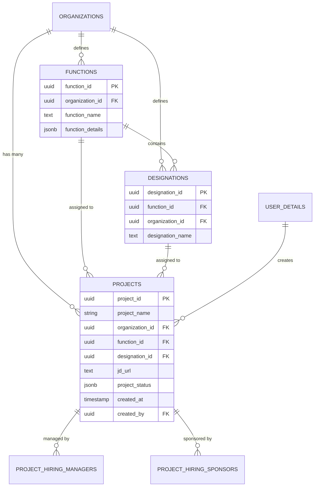
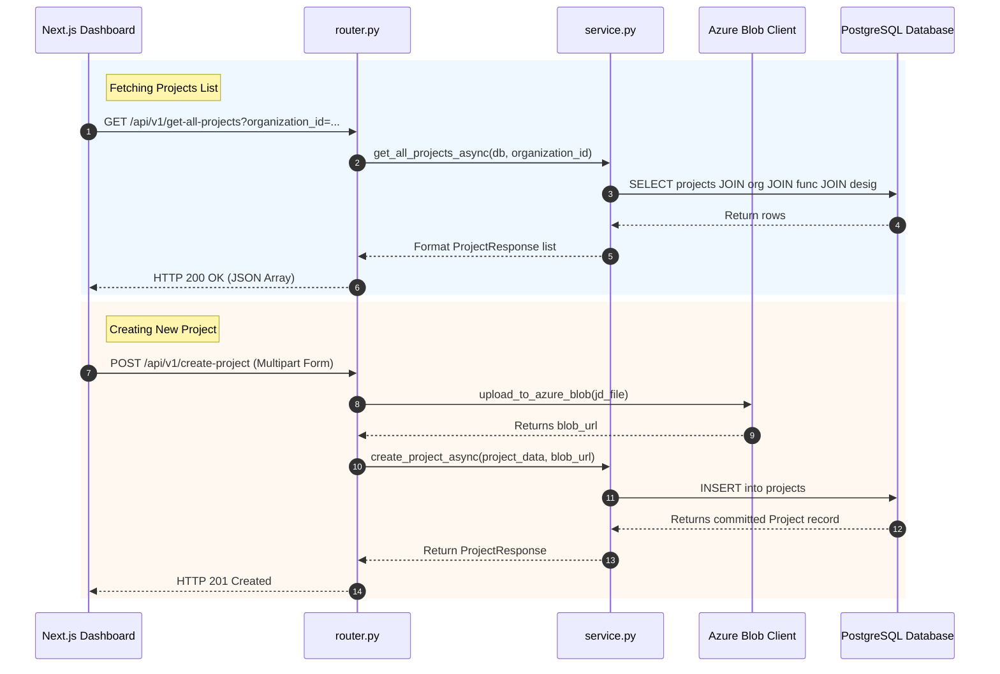

# 🏗️ Backend & Project Module Architecture Specification

This document provides a comprehensive technical reference for the backend codebase, with an in-depth deep-dive into the **Project Module**, file tree structure, core execution flows, database schema, and function definitions.

---

## 📌 Table of Contents
1. [Executive Architecture Overview](#1-executive-architecture-overview)
2. [Complete Directory & File Tree Hierarchy](#2-complete-directory--file-tree-hierarchy)
3. [Core & Shared Infrastructure Layers](#3-core--shared-infrastructure-layers)
4. [Project Module Deep-Dive](#4-project-module-deep-dive)
   - [A. Router Layer (`router.py`)](#a-router-layer-routerpy)
   - [B. Service Layer (`service.py`)](#b-service-layer-servicepy)
   - [C. Schema Layer (`schema.py`)](#c-schema-layer-schemapy)
   - [D. Model Layer (`model.py`)](#d-model-layer-modelpy)
5. [Database Entity Relationship Diagram (ERD) & Schemas](#5-database-entity-relationship-diagram-erd--schemas)
6. [Cross-Module Integration & Execution Flows](#6-cross-module-integration--execution-flows)
7. [Developer Maintenance & Testing Guide](#7-developer-maintenance--testing-guide)

---

## 1. Executive Architecture Overview

The backend is built on **FastAPI**, **AsyncSQLAlchemy**, **Pydantic v2**, **Celery**, and **LangGraph**, using a clean **Modular Layered Architecture**:

```
Client (Next.js Frontend)
       │ HTTP / REST API (Async)
       ▼
 ┌─────────────────────────────────────────────────────────────┐
 │ Router Layer (FastAPI APIRouter)                            │
 │ - Validates request payloads via Pydantic Schemas          │
 │ - Handles authentication & organization context middleware  │
 └──────────────────────────────┬──────────────────────────────┘
                                │
                                ▼
 ┌─────────────────────────────────────────────────────────────┐
 │ Service Layer (Async Business Logic)                        │
 │ - Executes DB transactions & async queries                  │
 │ - Integrates Azure Blob Storage & Celery Tasks              │
 └──────────────────────────────┬──────────────────────────────┘
                                │
                                ▼
 ┌─────────────────────────────────────────────────────────────┐
 │ Model Layer (SQLAlchemy ORM + PostgreSQL)                   │
 │ - PostgreSQL Database Tables & Foreign Key Constraints      │
 └─────────────────────────────────────────────────────────────┘
```

---

## 2. Complete Directory & File Tree Hierarchy

```
backend/
├── main.py                          # FastAPI Application Entry Point & Route Registrations
├── pyproject.toml                   # Project Dependencies & Tooling Config
├── .env                             # Environment Variables & Secret Configuration
├── core/                            # Core System Configuration & Middleware
│   ├── config.py                    # Environment settings (DB URLs, Azure keys, Secret keys)
│   ├── database.py                  # SQLAlchemy Async Engine & SessionMaker setup
│   ├── exception.py                 # Custom HTTP exception handlers & error wrappers
│   ├── langgraph_db.py              # Postgres Checkpointer setup for LangGraph agent state
│   ├── logging.py                   # Structured logging configuration
│   └── middleware/                  # CORS, Auth Token, & Org Context Middlewares
├── shared/                          # Cross-Module Shared Helpers & Utilities
│   ├── celery.py                    # Celery Background Worker Configuration
│   ├── redis.py                     # Redis Client & Caching connection manager
│   ├── sse_stream.py                # Server-Sent Events (SSE) streaming helpers
│   ├── file_extraction.py           # PDF / DOCX text extraction utilities
│   └── db/
│       └── base.py                  # Base SQLAlchemy Declarative Model class
└── modules/                         # Feature Modules (Domain-Driven Design)
    ├── project/                     # 🚀 PROJECT MODULE (Deep-dive below)
    │   ├── model.py                 # SQLAlchemy ORM Models (Project, Function, Designation)
    │   ├── router.py                # FastAPI HTTP Route Handlers
    │   ├── schema.py                # Pydantic Request & Response Models
    │   ├── service.py               # Async Business Logic & Azure Blob integration
    │   ├── designation_function_router.py  # Function/Designation lookup endpoints
    │   └── designation_function_service.py # Function/Designation DB service queries
    ├── assessment/                  # Assessment Configuration Module
    ├── assessment_attempt/          # Candidate Exam Attempt & Evaluation Module
    ├── roadmap_agent/               # LangGraph Agent for Personalized Roadmap Generation
    ├── doubt_solver_agent/          # AI Doubt Solver LangGraph Graph Manager
    ├── organization/                # Organization Management Module
    └── user/                        # User Details & Authentication Module
```

---

## 3. Core & Shared Infrastructure Layers

### 🔑 Key System Files

1. **[`backend/main.py`](file:///c:/Users/Admin/Downloads/code_sharing_31082026/backend/main.py)**
   - Initializes FastAPI application instance (`app = FastAPI(...)`).
   - Configures CORS origins and mounts global exception handlers.
   - Includes all module routers with `/api/v1` route prefix.

2. **[`backend/core/database.py`](file:///c:/Users/Admin/Downloads/code_sharing_31082026/backend/core/database.py)**
   - Creates `create_async_engine` using `DATABASE_URL`.
   - Exports `async_session_maker` dependency `get_db()` for FastAPI route dependency injection.

3. **[`backend/shared/celery.py`](file:///c:/Users/Admin/Downloads/code_sharing_31082026/backend/shared/celery.py)**
   - Configures Celery app with Redis broker and PostgreSQL result backend.
   - Ensures `WindowsSelectorEventLoopPolicy` is enforced on Windows OS workers.

---

## 4. Project Module Deep-Dive

Location: [`backend/modules/project/`](file:///c:/Users/Admin/Downloads/code_sharing_31082026/backend/modules/project)

### A. Router Layer (`router.py`)
File Path: [`backend/modules/project/router.py`](file:///c:/Users/Admin/Downloads/code_sharing_31082026/backend/modules/project/router.py)

| Endpoint | Method | Response Model | Important Function / Description |
| :--- | :--- | :--- | :--- |
| `/api/v1/get-all-projects` | `GET` | `list[ProjectResponse]` | [`get_projects()`](file:///c:/Users/Admin/Downloads/code_sharing_31082026/backend/modules/project/router.py#L202): Fetches all projects filtered by `organization_id` using outer joins for Organization, Function, and Designation names. |
| `/api/v1/create-project` | `POST` | `ProjectResponse` | [`create_project()`](file:///c:/Users/Admin/Downloads/code_sharing_31082026/backend/modules/project/router.py#L70): Receives multipart form data (`project_data` JSON + `jd_file`), uploads JD to Azure Blob, resolves functions/designations, and creates project. |
| `/api/v1/project/details` | `POST` | `ProjectResponse` | [`get_project_details()`](file:///c:/Users/Admin/Downloads/code_sharing_31082026/backend/modules/project/router.py#L216): Fetches full metadata for a specific project by `project_id`. |
| `/api/v1/delete-project` | `DELETE` | `dict` | [`delete_project()`](file:///c:/Users/Admin/Downloads/code_sharing_31082026/backend/modules/project/router.py#L228): Deletes project record and associated hiring manager/sponsor links. |
| `/api/v1/project/{id}/status` | `PUT` | `dict` | [`change_project_status()`](file:///c:/Users/Admin/Downloads/code_sharing_31082026/backend/modules/project/router.py#L247): Updates project status (`active`, `draft`, `archived`). |

---

### B. Service Layer (`service.py`)
File Path: [`backend/modules/project/service.py`](file:///c:/Users/Admin/Downloads/code_sharing_31082026/backend/modules/project/service.py)

| Function Name | Signature & Parameters | Key Operations |
| :--- | :--- | :--- |
| [`get_all_projects_async()`](file:///c:/Users/Admin/Downloads/code_sharing_31082026/backend/modules/project/service.py#L510) | `(db: AsyncSession, organization_id: Optional[UUID] = None)` | Performs SQL `outerjoin` on `Project`, `Organization`, `Function`, `Designation`. Filters by `organization_id` when provided. |
| [`create_project_async()`](file:///c:/Users/Admin/Downloads/code_sharing_31082026/backend/modules/project/service.py#L78) | `(db: AsyncSession, project_data: dict, blob_url: Optional[str] = None)` | Parses form data, auto-creates missing Function/Designation entities, and inserts the `Project` ORM instance. |
| [`get_project_by_id_async()`](file:///c:/Users/Admin/Downloads/code_sharing_31082026/backend/modules/project/service.py#L243) | `(db: AsyncSession, project_id: UUID)` | Fetches single project detail record by UUID key. |
| [`update_project_status_async()`](file:///c:/Users/Admin/Downloads/code_sharing_31082026/backend/modules/project/service.py#L380) | `(db: AsyncSession, project_id: UUID, status_in: ProjectStatus)` | Updates `project_status` JSON field and records state transition history. |

---

### C. Schema Layer (`schema.py`)
File Path: [`backend/modules/project/schema.py`](file:///c:/Users/Admin/Downloads/code_sharing_31082026/backend/modules/project/schema.py)

Key Pydantic Models:
- [`ProjectCreate`](file:///c:/Users/Admin/Downloads/code_sharing_31082026/backend/modules/project/schema.py#L20): Request model containing `project_name`, `function_name`, `designation_name`, `hiring_goal`, `role_description`.
- [`ProjectResponse`](file:///c:/Users/Admin/Downloads/code_sharing_31082026/backend/modules/project/schema.py#L45): Response model containing `project_id`, `project_name`, `organization_name`, `function_name`, `designation_name`, `jd_url`, `created_at`.
- [`ProjectDetailsRequest`](file:///c:/Users/Admin/Downloads/code_sharing_31082026/backend/modules/project/schema.py#L60): Simple payload model containing `project_id`.

---

### D. Model Layer (`model.py`)
File Path: [`backend/modules/project/model.py`](file:///c:/Users/Admin/Downloads/code_sharing_31082026/backend/modules/project/model.py)

Defines database tables mapping directly to PostgreSQL:
- **`Project`**: Represents primary project table ([`projects`](file:///c:/Users/Admin/Downloads/code_sharing_31082026/backend/modules/project/model.py#L12)).
- **`ProjectHiringManager`**: Join table mapping projects to hiring manager users ([`project_hiring_managers`](file:///c:/Users/Admin/Downloads/code_sharing_31082026/backend/modules/project/model.py#L57)).
- **`ProjectHiringSponsor`**: Join table mapping projects to hiring sponsors ([`project_hiring_sponsors`](file:///c:/Users/Admin/Downloads/code_sharing_31082026/backend/modules/project/model.py#L76)).
- **`Function`**: Department/Function lookup table ([`functions`](file:///c:/Users/Admin/Downloads/code_sharing_31082026/backend/modules/project/model.py#L99)).
- **`Designation`**: Designation level lookup table ([`designations`](file:///c:/Users/Admin/Downloads/code_sharing_31082026/backend/modules/project/model.py#L120)).

---

## 5. Database Entity Relationship Diagram (ERD) & Schemas



---

## 6. Cross-Module Integration & Execution Flows

### 🔄 Project Creation & List Fetching Sequence



---

## 7. Developer Maintenance & Testing Guide

### Server Execution Commands

- **Run FastAPI Backend Server**:
  ```bash
  cd backend
  uv run uvicorn main:app --reload --port 8000
  ```

- **Run Celery Background Worker**:
  ```bash
  cd backend
  uv run celery -A shared.celery.celery_app worker --loglevel=info -P threads
  ```

- **Interactive API Documentation (Swagger)**:
  Open [http://localhost:8000/docs](http://localhost:8000/docs) in browser.
